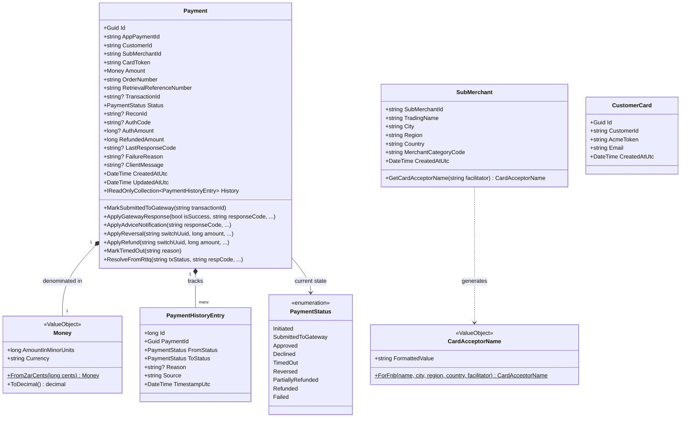
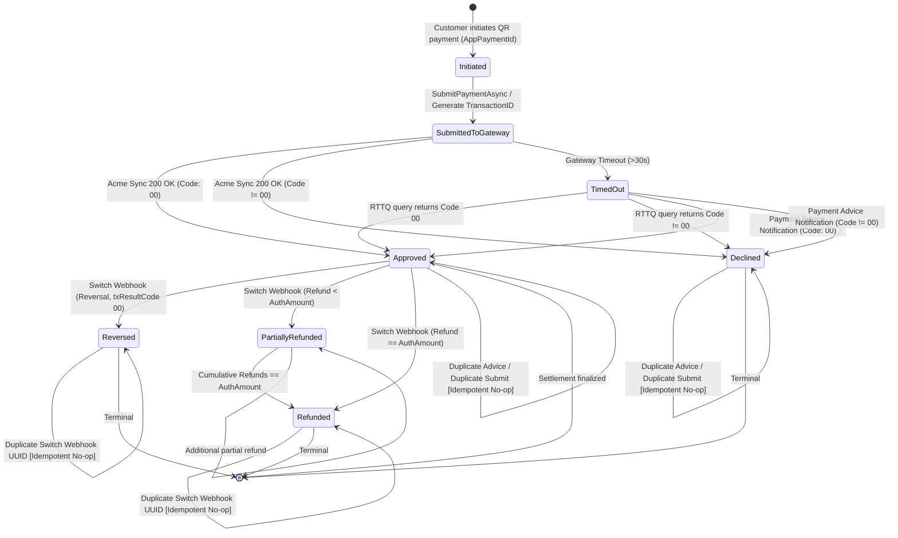
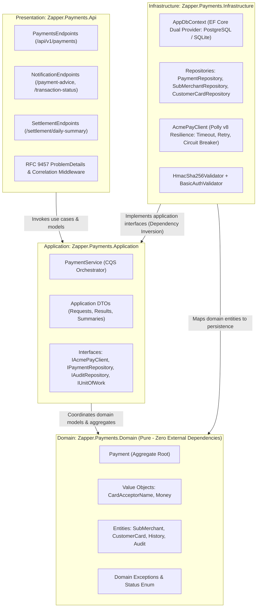
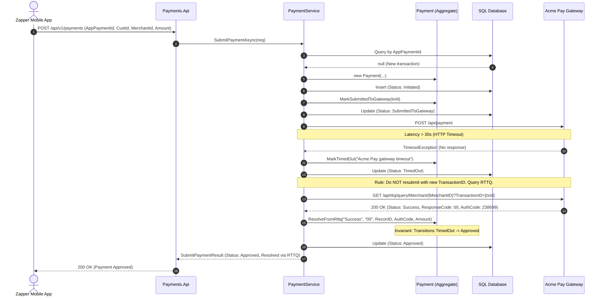
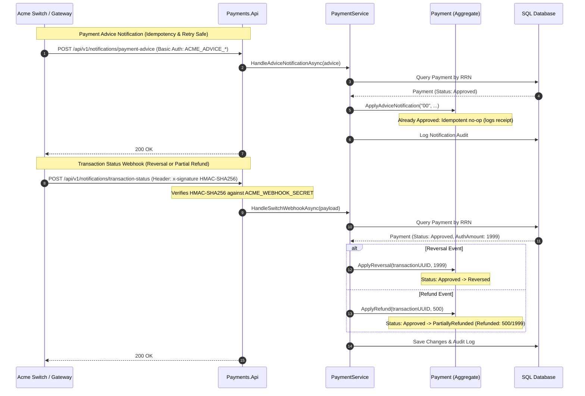

# Architecture & UML Specification: Zapper Payments Integration Service

**Document Version:** 1.1  
**Date:** 2026-10-22  
**Owner:** Team Lead Software Engineer  
**Methodology:** 4+1 View Model & UML 2.5 + C4 Standard (Mermaid Diagrams as Code)

---

## 1. Logical View: UML Class & Domain Model Diagram

---

## 2. Process & Lifecycle View: UML State Machine Diagram

This diagram governs the `Payment` Aggregate Root lifecycle, formalizing all allowed state transitions, triggers, and guard invariants:

---

## 3. Development View: UML Package & Layering Diagram

---

## 4. Scenario View: UML Dynamic Sequence Diagram (+1 Scenarios)

### Scenario A: Payment Submission with Acme Timeout & Immediate RTTQ Fallback

### Scenario B: Asynchronous Lifecycle Callbacks (Advice & Reversal/Refund Webhook)

---

## 5. Architectural Quality Attributes & Decisions Matrix

| UML Viewpoint | Quality Attribute | Architectural Mechanism | Verification / Invariant |
|---|---|---|---|
| **Class Model** | Domain Integrity | Pure Domain Aggregate + Value Objects (`Money`, `CardAcceptorName`) | Unit tested in milliseconds without database or HTTP mocks |
| **State Machine** | Consistency & Fault Tolerance | Finite State Machine with Terminal State Locks | Prevents out-of-order Advice from regressing `Reversed` or `Refunded` payments |
| **Sequence (+1)** | High Availability & Resilience | Polly v8 standard resilience + RTTQ fallback query | Outbound calls do not block threads; timeouts automatically query transaction state |
| **Package** | Maintainability & Testability | Clean Architecture / Onion Layering (DIP) | Presentation and Infrastructure depend inwards; Domain depends on nothing |
| **Security** | Integrity & Authenticity | Basic Auth (Advice) + HMAC-SHA256 (Switch Webhook) | Rejects forged callbacks before business logic is touched |
